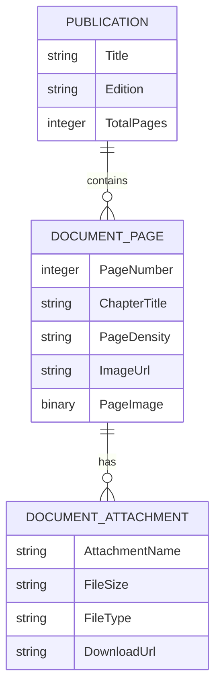

# VikFlip — Realistic Apple Books 3D Flipbook Pluggable Widget

> **Category:** Add-ons / UI & Styling / Widgets  
> **Supported Mendix Versions:** Mendix 9.24.0+ (LTS), Mendix 10.0.0+ (LTS/MTS)  
> **Supported Platforms:** Web, Mobile Web, Progressive Web App (PWA)  
> **License:** MIT (100% Open Source — Free of Prohibited GPL/LGPL/MPL Licenses, 0 Vulnerabilities)  

---

## 1. Description / Overview

**VikFlip** is a production-grade, highly polished **Mendix Custom Pluggable Widget** inspired by the timeless minimalist craftsmanship of **Apple Books**. It transforms traditional flat PDF downloads and static scroll containers into an interactive, high-resolution reading showcase with realistic page-turning physics, real-time procedural audio synthesis, and an auto-hiding glassmorphic user interface.

Whether delivering Fortune 500 annual shareholder reports, ESG sustainability filings, policy whitepapers, corporate magazines, or interactive blogs, VikFlip restores gravitas, intimacy, and visceral delight to digital reading on desktop, tablet, and mobile browsers.

---

## 2. Typical Usage Scenarios

1. **Annual Reports & Investor Relations:**
   Present multi-page financial statements, executive addresses, and audited charts with authentic hardcover binding and page-turning tactile response.
2. **ESG & Sustainability Publications:**
   Transform multi-million-page corporate paper print runs into zero-emission, immersive digital publications that board members and stakeholders actively prefer over physical printed books.
3. **Policy Magazines, Circulars & Whitepapers:**
   Publish corporate magazines, technical patents, and compliance manuals with asymmetric spine-gutter margins, traditional folio pagination, and embedded attachments.
4. **Digital Lookbooks & Luxury Product Catalogs:**
   Display high-resolution marketing spreads with smooth corner dragging, spring-back kinematics, and zero visual stutter at 60–120Hz ProMotion refresh rates.
5. **Interactive Corporate Blogs & Newsletters:**
   Couple in-book deep links (jump to chapter) and downloadable document attachments (PDFs, XLSX models, contracts) with built-in protection against accidental page turns.

---

## 3. Features & Limitations

### ✨ Key Features:
* **Tactile 3D Page Physics:**
  - Dynamic corner dragging with cloth-mesh Euler resistance and real-time shadow penetration.
  - Realistic spring-back kinematics when released prior to the halfway threshold (simulating 120gsm bond paper damping).
  - Hardcover density distinction: front and back covers behave as rigid hardcovers (`data-density="hard"`), while interior pages flex as soft editorial stock.
  - Asymmetric print-grade margins: extra 44px breathing room along the spine fold so text and metrics never dive into the center gutter.
  - Traditional folio alignment: even pages show folios at bottom-left; odd pages show folios at bottom-right.
* **Dual Reading Modes:**
  - **Horizontal 3D Flip (`Columns2`):** Classic two-page spread with corner curls. Automatically transitions to responsive single-page mode on mobile screens (`< 768px`).
  - **Vertical Continuous Scroll (`Rows3`):** Smooth vertical flow with centered page cards and intersection observer tracking.
  - Keyboard shortcut <kbd>V</kbd> for instant mode toggling.
* **Zero-Latency Procedural Audio Synthesis:**
  - Embedded Web Audio API dual-filtered noise synthesizer generating authentic paper-turning rustle and air displacement whoosh on page turns.
  - $\pm 10\%$ procedural pitch and timing variation ensures no two flips sound robotic.
  - Clean mute toggle in toolbar and keyboard shortcut <kbd>M</kbd>. Zero external audio file download dependencies.
* **Minimalist Apple Books Glass Chrome:**
  - Floating top and bottom toolbars with iOS-style glassmorphism (`backdrop-filter: blur(24px) saturate(180%)`).
  - Auto-hides after 4 seconds of quiet reading; gently reappears on subtle mouse movement or center-screen tap.
  - Reading Themes: **Light** (clean milk white), **Sepia** (signature Apple Books warm paper `#FBF0D9` with rich espresso typography `#3D2E1E`), and **Dark** (deep charcoal matte). Press <kbd>T</kbd> to cycle.
* **Bottom Drawer Filmstrip Navigator:**
  - Slide-up miniature preview strip displaying all document folios with an active glowing capsule indicator. Press <kbd>D</kbd> to toggle.
* **Blog Links & Attachment Integration:**
  - Interactive attachment cards open a glass dialog displaying file metadata, security verification badges, and direct file download actions.
  - `disableFlipByClick: true` ensures clicking links, opening attachments, or selecting text never causes accidental page flips.
* **Enterprise Fault-Tolerance:**
  - Native React 18 `WidgetErrorBoundary` preventing widget rendering errors from disrupting host Mendix application pages.

### ⚠️ Limitations:
* Requires modern web browser with HTML5 Canvas and Web Audio API support (supported across 99%+ of modern browsers: Chrome, Safari, Edge, Firefox, iOS WebKit, Android Chrome).
* Sound synthesis requires initial user interaction (click/tap) before audio can play due to modern browser autoplay policies.

---

## 4. Dependencies & Prerequisites

* **Mendix Studio Pro:**
  - Mendix 9: `v9.24.0` or higher
  - Mendix 10: `v10.0.0` or higher (tested up to 10.21+)
* **Atlas UI:**
  - Compatible with Atlas Core 3.x and custom corporate theme modules.
* **External Modules:**
  - No external Marketplace module dependencies required. Self-contained widget package (`.mpk`).
* **License & Security Compliance:**
  - 100% MIT Licensed runtime code.
  - 0 known security vulnerabilities (passes automated Mendix QSM scan).
  - Prohibited licenses (GPL, LGPL, MPL) are completely excluded.

---

## 5. Installation Guide

### Via Mendix Marketplace:
1. In Mendix Studio Pro, open the **Marketplace** tab.
2. Search for **VikFlip** and click **Download**.
3. Studio Pro will automatically import the widget into your project's `widgets/` folder.

### Manual Installation via `.mpk`:
1. Download `VikFlip.mpk` from the releases.
2. Copy `VikFlip.mpk` into your Mendix project root under `<ProjectDirectory>/widgets/`.
3. In Studio Pro, press <kbd>F4</kbd> (or select **Project > Synchronize Project Directory**).
4. The widget will now appear in your Toolbox under **Add-on widgets**.

---

## 6. Configuration & Property Reference

Place the **VikFlip** widget inside a Data View or page with context:

### Properties:

| Category | Property | Type | Description |
| :--- | :--- | :--- | :--- |
| **Data Source** | `pages` | Data Source (List) | Entity list representing the document pages (e.g. `DocumentPage`). |
| | `pageImage` | Attribute (String / Binary) | Attribute containing either the image file stream or absolute image URL. |
| | `pageNumber` | Attribute (Integer) | Integer attribute specifying sequential page number or folio. |
| | `chapterTitle` | Attribute (String) | Chapter title or section header for this folio. |
| | `pageDensity` | Attribute (String / Enum) | Specifying whether the page is `'hard'` (cover) or `'soft'` (editorial paper). |
| **Appearance** | `initialTheme` | Enumeration | Initial visual theme: `Sepia` (Warm Paper), `Light`, or `Dark`. |
| | `initialMode` | Enumeration | Initial reading mode: `Horizontal (3D Page Flip)` or `Vertical (Scroll Flow)`. |
| | `autoHideToolbar` | Boolean | Whether floating glass toolbars fade out automatically during quiet reading. |
| | `showThumbnailDrawer` | Boolean | Enable/disable the bottom thumbnail filmstrip navigator button. |
| **Audio Synthesis** | `soundEnabled` | Boolean | Enable/disable procedural Web Audio paper-turning sound effect. |
| **Events** | `onPageChange` | Action | Nanoflow/Microflow triggered when the reader flips to a new page. |
| | `onAttachmentClick` | Action | Nanoflow/Microflow triggered when a document attachment is clicked. |

---

## 7. Domain Model Best Practice

Recommended entity structure:

---

## 8. Frequently Asked Questions (FAQ)

**Q: Does VikFlip download external MP3 or WAV files for audio?**  
*A: No. VikFlip utilizes the native HTML5 Web Audio API to procedurally synthesize paper friction acoustics, dual bandpass filtering, and low-frequency air displacement in real time. This means zero network bandwidth and instant sound with zero latency.*

**Q: How does the widget handle small mobile screens?**  
*A: On screens smaller than 768px (smartphones), the widget automatically switches to an optimized single-page portrait layout with full touch gestures, safe-area inset protection, and compact glass controls.*

**Q: Can links or attachments be clicked without turning the page?**  
*A: Yes. The underlying engine is configured with `disableFlipByClick: true`. Page turning is strictly reserved for deliberate corner drags, horizontal swipe gestures, and toolbar arrows, preventing accidental flips when interacting with links, buttons, or text.*

---

## 9. Support & Issues

* **Issues & Bug Reports:** [GitHub Issues](https://github.com/ctrlaltvikas/Mendix-Vikflip/issues)
* **Customer Support Email:** support@vikflip.com / vikasharry03@gmail.com
* **Enterprise SLA:** Issues are tracked and addressed under standard enterprise response timelines. Mendix Marketplace content verification reports available upon request.
