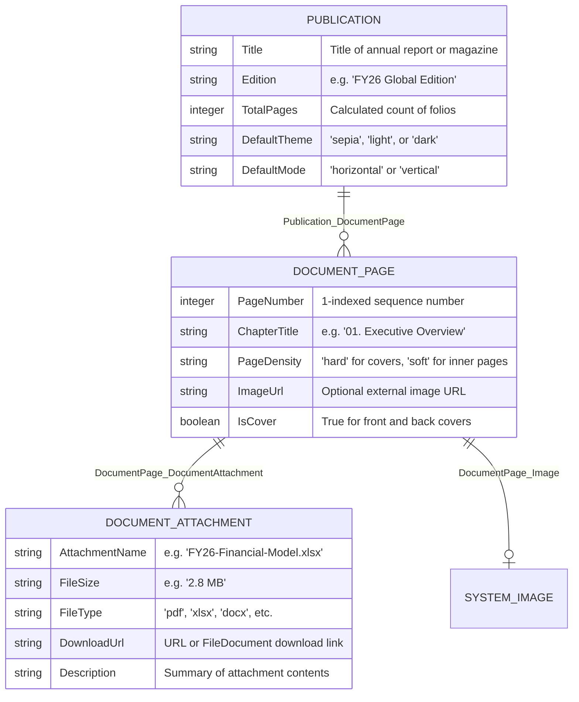

# Domain Model & Microflow Integration Guide for VikFlip

This guide provides a reference domain model, entity attributes, associations, and microflow configurations for seamlessly wiring **VikFlip** into any Mendix application.

---

## 1. Reference Domain Model

In your Mendix Studio Pro domain model editor (e.g., inside a module called `DigitalPublishing` or `DocumentViewer`):



---

## 2. Microflows & Data Retrieval

### A. Data Source Microflow: `DS_GetPublicationPages`
When configuring the **Pages Data Source** property as a Microflow:
1. Input parameter: `Publication (Object)`.
2. Retrieve `DocumentPage` list from database or association:
   - XPath constraint: `[DigitalPublishing.Publication_DocumentPage = $Publication]`
   - Sorting: `PageNumber` Ascending.
3. Return the `List of DocumentPage`.

---

### B. Event Microflow: `ACT_OnPageChange`
Triggered automatically whenever the user turns a page or jumps to a chapter:
1. Input parameters:
   - `CurrentPage (Integer)`
   - `Publication (Object)`
2. Use cases:
   - Log audit analytics in your database (e.g., tracking reader drop-off rates on specific corporate disclosures).
   - Save reading progress / bookmarks for authenticated users.

---

### C. Event Microflow: `ACT_OnAttachmentClick`
Triggered when the reader clicks a verified attachment card:
1. Input parameter:
   - `DocumentAttachment (Object)`
2. Actions:
   - Download the file stream using Mendix standard **Download File** activity.
   - Alternatively, open an external secure document portal in a new browser tab.

---

## 3. Seed Data Generation Script (`SUB_GenerateSamplePublication`)

If you want to quickly populate your Mendix database with sample pages matching the Apple Books demo:

```text
1. Create Publication:
   - Title = 'VikFlip Annual Report 2026'
   - Edition = 'FY26 Global Edition'
   - DefaultTheme = 'sepia'
   - DefaultMode = 'horizontal'

2. Create DocumentPage 1 (Front Cover):
   - PageNumber = 1
   - ChapterTitle = 'Cover'
   - PageDensity = 'hard'
   - IsCover = true

3. Create DocumentPage 2 (Executive Letter):
   - PageNumber = 2
   - ChapterTitle = 'Executive Address'
   - PageDensity = 'soft'

4. Create DocumentPage 3 (Table of Contents):
   - PageNumber = 3
   - ChapterTitle = '01. Executive Overview'
   - PageDensity = 'soft'

5. Create DocumentPage 10 (Back Cover):
   - PageNumber = 10
   - ChapterTitle = 'End Matter'
   - PageDensity = 'hard'
   - IsCover = true
```

---

## 4. Best Practices for High Performance
- **Image Optimization:** For high-DPI displays (Retina/ProMotion screens), optimize page images to approximately `1200 x 1650 px` in WebP or PNG format.
- **Asymmetric Margins:** Interior content should leave at least 40px margin along the inner spine fold to preserve the book crease illusion.
- **Lazy Loading:** For publications with 100+ pages, configure your Mendix microflow or XPath with pagination limits to stream page batches on demand.
